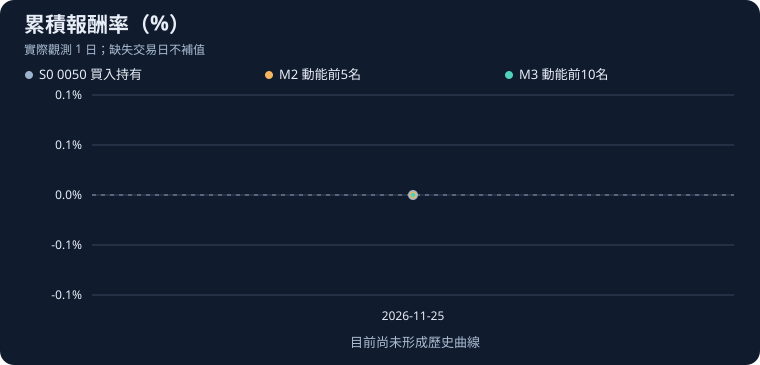
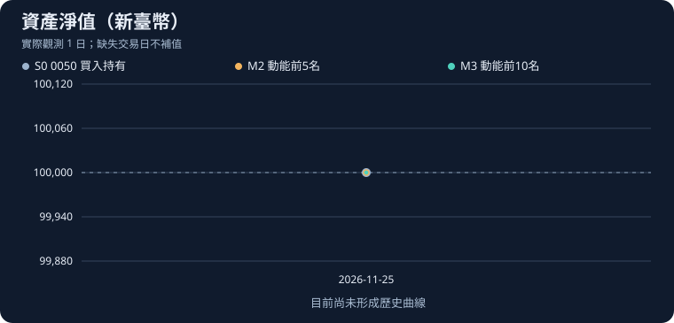
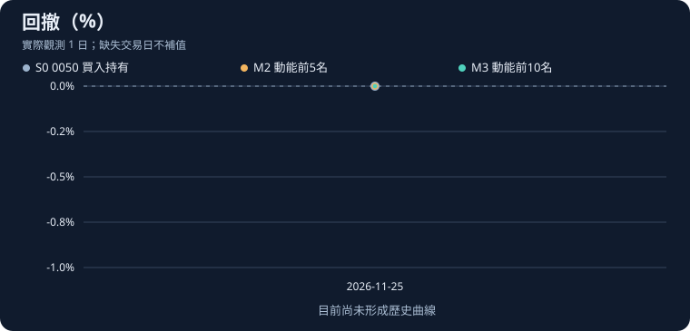
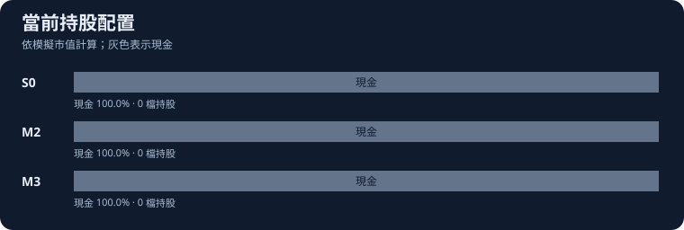

# 台股動能研究平台 · V0.7

**前瞻性研究｜虛擬本金｜不涉及實際交易**

[每日排行榜](README.md) · [歷史監測](HISTORY.md) · [詳細模擬帳本](PAPER.md) · [回測結果](../backtest/RESEARCH_RESULT.md) · [本次執行紀錄](https://github.com/kaoelvmpvm/taiwan-momentum-radar/actions/runs/45625299583)

排名行情日期：2026-11-25　｜　模擬估值日期：2026-11-25

本次流程通過。仍須以各資料日期為準；尚未建立部位不代表策略已完成實際驗證。

## 三組策略即時比較

| 策略 | 淨值（元） | 累積報酬 | 相對0050（百分點） | 最大回撤 | 累計成本 |
|---|---:|---:|---:|---:|---:|
| S0 0050 買入持有 | 100,000.00 | +0.00% | +0.00 | 0.00% | 0.00 |
| M2 動能前5名 | 100,000.00 | +0.00% | +0.00 | 0.00% | 0.00 |
| M3 動能前10名 | 100,000.00 | +0.00% | +0.00 | 0.00% | 0.00 |

## 真實觀測曲線

目前尚未形成跨日曲線；顯示實際初始觀測，不補造資料。

## 持股配置

### S0 0050 買入持有

| 股票 | 模擬市值（元） | 權重 |
|---|---:|---:|
| 現金 | 100,000.00 | 100.00% |

### M2 動能前5名

| 股票 | 模擬市值（元） | 權重 |
|---|---:|---:|
| 現金 | 100,000.00 | 100.00% |

### M3 動能前10名

| 股票 | 模擬市值（元） | 權重 |
|---|---:|---:|
| 現金 | 100,000.00 | 100.00% |

## 下一次換股與最近訊號

目前無待成交訊號。

## 當前強勢股（排名觀察，非換股指令）

| 排名 | 代碼 | 名稱 | 12個月動能 |
|---:|---|---|---:|
| 1 | 7610 | 聯友金屬-創 | +841.45% |
| 2 | 1303 | 南亞 | +334.34% |
| 3 | 6213 | 聯茂 | +274.55% |
| 4 | 3189 | 景碩 | +260.62% |
| 5 | 3037 | 欣興 | +233.07% |
| 6 | 3026 | 禾伸堂 | +220.33% |
| 7 | 2454 | 聯發科 | +215.43% |
| 8 | 3167 | 大量 | +203.49% |
| 9 | 8046 | 南電 | +166.56% |
| 10 | 3481 | 群創 | +152.06% |

## 交易成本與最近交易

| 策略 | 模擬買進次數 | 模擬賣出次數 | 累計成交參考金額（元） | 帳本累計成本（元） |
|---|---:|---:|---:|---:|
| S0 | 0 | 0 | 0.00 | 0.00 |
| M2 | 0 | 0 | 0.00 | 0.00 |
| M3 | 0 | 0 | 0.00 | 0.00 |

| 日期 | 策略 | 結果 | 買進 | 賣出 | 成本（元） |
|---|---|---|---|---|---:|
| — | — | 尚無模擬成交 | — | — | — |

[完整訊號、交易與淨值資料 JSON](paper_state.json)

## 研究限制

此頁只呈現現有帳本，不改動訊號、資金與成交規則。相對0050是累積報酬差，非風險調整後 Alpha。個股市值與配置權重不是個股損益貢獻；帳本未保存足夠逐日歸因資料，因此不估算個股貢獻。
每日排名使用當日ETF持股代理池。先前150檔探索性回測有倖存者偏誤，尚未完成無偏誤歷史驗證。模擬使用分數股、參考開盤價與預設費率，並非真實成交。私人 GitHub 文件，非公開網站。
